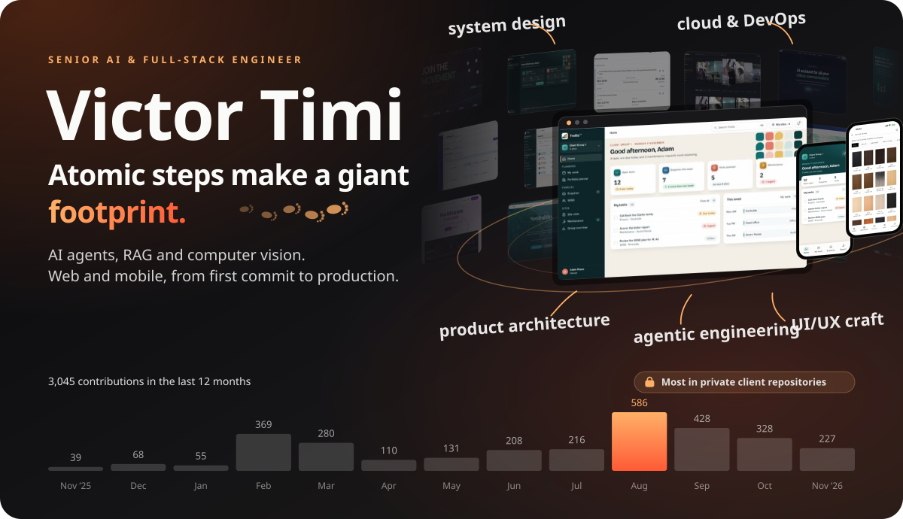

<picture><source media="(prefers-color-scheme: dark)" srcset="assets/proof-dark.svg">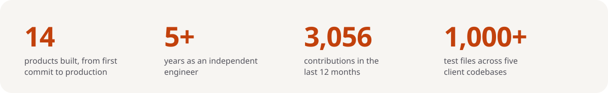</picture>

## Selected work

Most of what I build lives in private client repositories. These are the products, what they do and the call that shaped each one.

<a href="https://www.thinkidx.com"><picture><source media="(prefers-color-scheme: dark)" srcset="assets/work-thinkidx-dark.svg">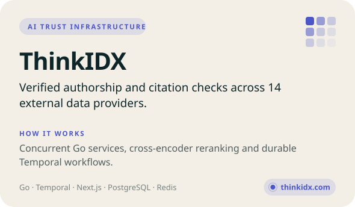</picture></a>
<picture><source media="(prefers-color-scheme: dark)" srcset="assets/work-wehverse-dark.svg">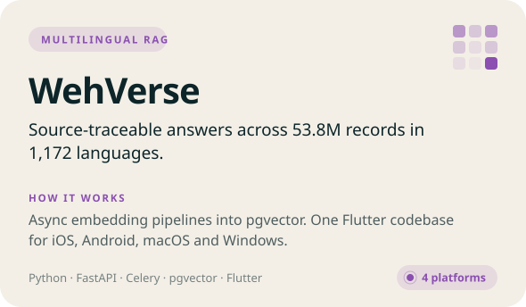</picture>

<picture><source media="(prefers-color-scheme: dark)" srcset="assets/work-qnotix-dark.svg">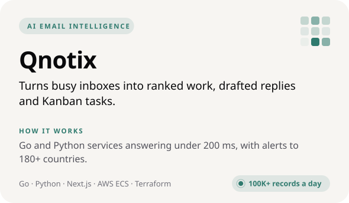</picture>
<picture><source media="(prefers-color-scheme: dark)" srcset="assets/work-campusreels-dark.svg">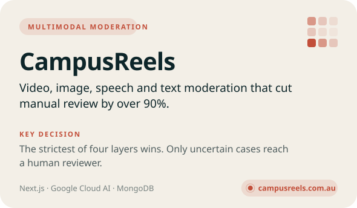</picture>

<a href="https://apps.apple.com/us/app/conde-hair-extensions/id6762065595"><picture><source media="(prefers-color-scheme: dark)" srcset="assets/work-conde-dark.svg">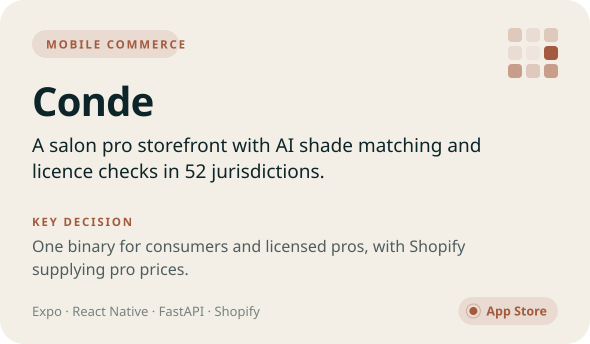</picture></a>
<picture><source media="(prefers-color-scheme: dark)" srcset="assets/work-cimpl3-dark.svg">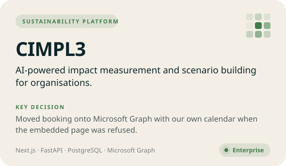</picture>

<picture><source media="(prefers-color-scheme: dark)" srcset="assets/work-trellis-dark.svg">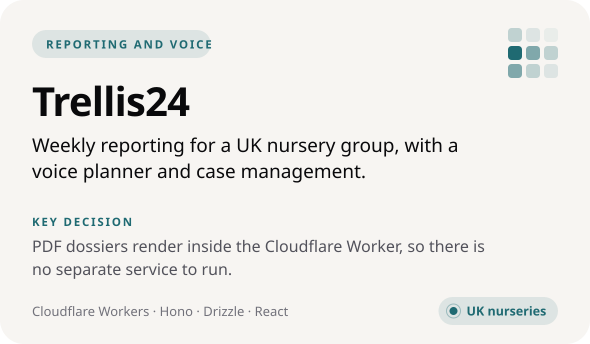</picture>
<picture><source media="(prefers-color-scheme: dark)" srcset="assets/work-sdg-dark.svg">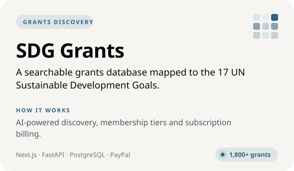</picture>

<picture><source media="(prefers-color-scheme: dark)" srcset="assets/also-dark.svg">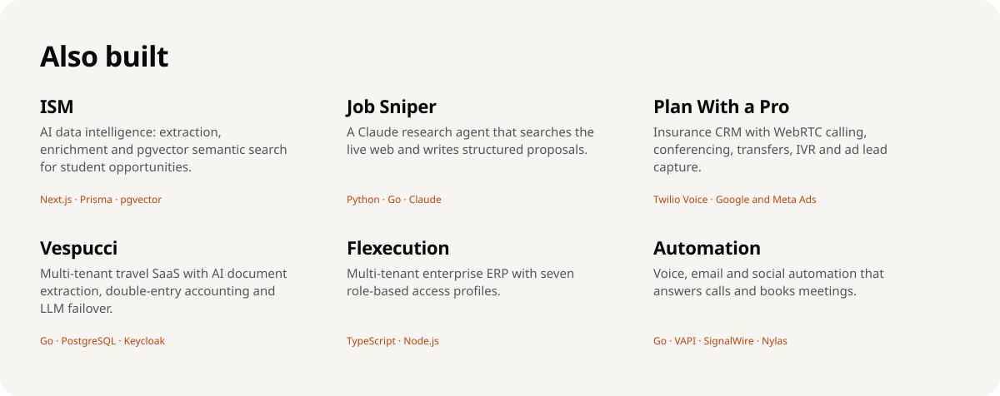</picture>

<picture><source media="(prefers-color-scheme: dark)" srcset="assets/how-dark.svg">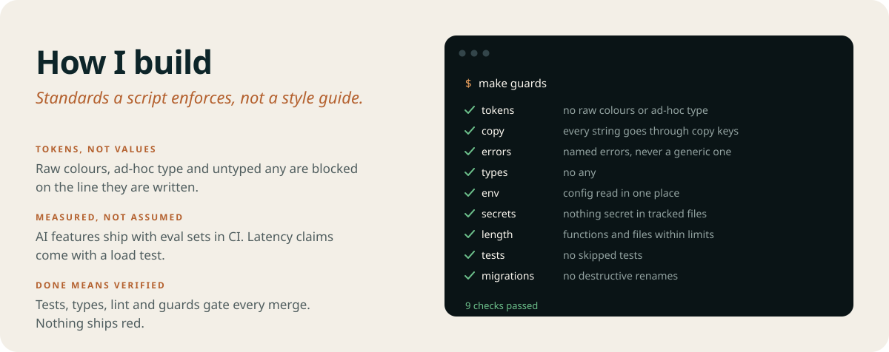</picture>

## Work with me

Open to contract work, consulting and remote roles in AI systems engineering, LLM architecture and full-stack development.

[X @victortimi_](https://x.com/victortimi_)
